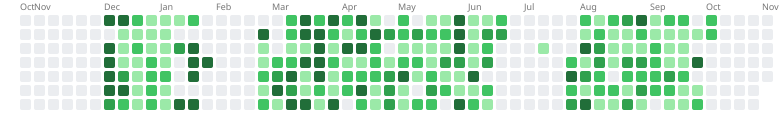

<samp>

- 443 problems solved &mdash; 203 Easy &middot; 185 Medium &middot; 55 Hard
- Current streak: 38 days (longest: 38 days) &middot; 195 active days total

</samp>

### <samp> heatmap.<samp>



### <samp> tags. <samp>

<samp>

<!--START_SECTION:tags-->

```txt
Array                279 problems   ███████▓░░░░░░░░░░░░░░░░░   31.14 %
String               114 problems   ███░░░░░░░░░░░░░░░░░░░░░░   12.72 %
Hash Table           94 problems    ██▓░░░░░░░░░░░░░░░░░░░░░░   10.49 %
Math                 85 problems    ██░░░░░░░░░░░░░░░░░░░░░░░   09.49 %
Dynamic Programming  82 problems    ██░░░░░░░░░░░░░░░░░░░░░░░   09.15 %
Sorting              63 problems    █▓░░░░░░░░░░░░░░░░░░░░░░░   07.03 %
Two Pointers         52 problems    █░░░░░░░░░░░░░░░░░░░░░░░░   05.80 %
Matrix               46 problems    █░░░░░░░░░░░░░░░░░░░░░░░░   05.13 %
Greedy               44 problems    █░░░░░░░░░░░░░░░░░░░░░░░░   04.91 %
Binary Search        37 problems    █░░░░░░░░░░░░░░░░░░░░░░░░   04.13 %
```

<!--END_SECTION:tags-->

</samp>

> [!NOTE]
> Auto-generated by [`.leetcode-sync/sync.py`](.leetcode-sync/sync.py) from my live LeetCode profile &mdash; do not edit by hand

<samp><sub>Last updated: 2026-11-06 15:47</sub></samp>
